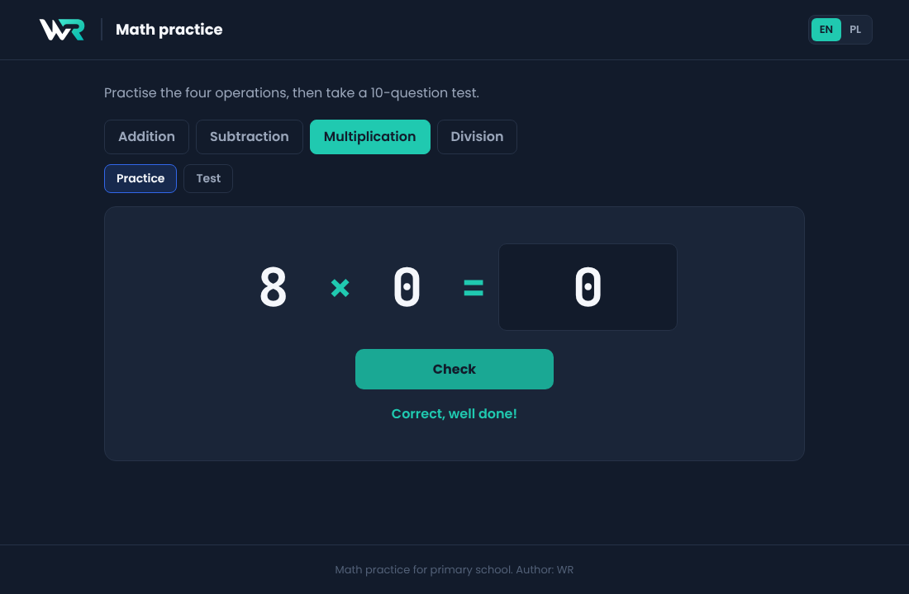
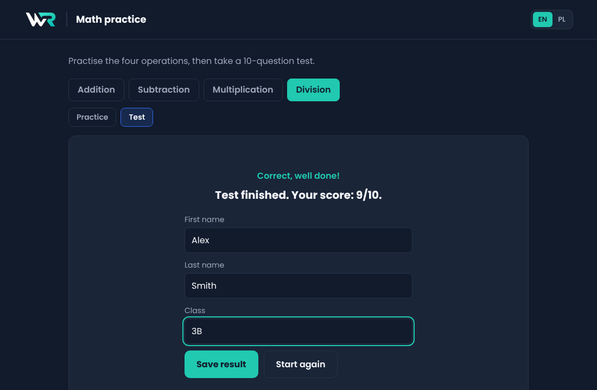
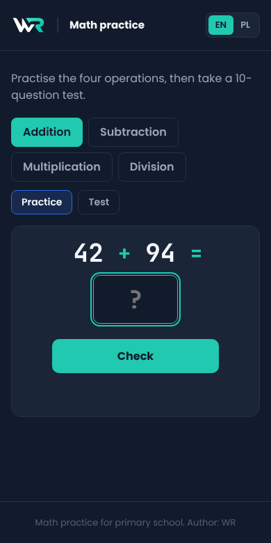

<p>
  
</p>

<p>&nbsp;<a href="README.pl.md"></a></p>

<p>
  
  
  
  <a href="../../actions/workflows/ci.yml"></a>
  
</p>

**Website for practising addition, subtraction, multiplication and division.**
Two modes: endless practice with instant feedback, or a 10-question test whose score is saved to the database with the pupil's name and class.

<p align="center"></p>

## Features

- **Four operations**: subtraction never goes below zero, division always has a whole result.
- **Practice and Test** modes; the test saves the score with a prepared statement (no SQL injection).
- **English and Polish** on one page (`?lang=en|pl`, browser language by default).
- **WR look**: logo, ink and signal colours, Poppins and JetBrains Mono; works on phones.

## Quick start

Requirements: PHP 8.1+ with `pdo_mysql`, MariaDB or MySQL.

```bash
git clone https://github.com/vviktooor/mathLearningSite.git
cd mathLearningSite
mysql -e 'CREATE DATABASE math_learning' && mysql math_learning < db/schema.sql
DB_USER=... DB_PASSWORD=... php -S localhost:8080 -t public
```

Open http://localhost:8080. On XAMPP point the virtual host at `public/`.

## Configuration

Database settings come from environment variables (see `.env.example`): `DB_HOST`, `DB_NAME`, `DB_USER`, `DB_PASSWORD`.

## Test mode

After ten questions the pupil sees the score and saves it; on a phone the layout stacks:

<p align="center">&nbsp;</p>

## Languages

This README is available in English (default) and [Polish](README.pl.md). Interface: English by default (or the browser language), Polish via the EN/PL switch or `?lang=pl`. Strings live in `lang/en.php` and `lang/pl.php`.

## Repository layout

| Where | What |
|---|---|
| `public/index.php` | The only page: language, operation and mode from the URL |
| `public/save.php` | Saves a finished test (prepared statement) |
| `public/assets/` | `quiz.js` (logic), `app.js` (page), `style.css`, WR logo |
| `lang/` | `en.php` and `pl.php` |
| `db/schema.sql` | Results table |
| `tests/` | Node tests for the quiz logic, PHP check for language parity |
| `docs/screenshots/` | Screenshots from the running site |

## Tests and quality

```bash
npm test
php tests/lang_test.php
for f in public/*.php lang/*.php; do php -l "$f"; done
```

| Check | Result | Date |
|---|---|---|
| Tests | PASS (3/3 Node, 26/26 language keys) | 2026-11-25 |
| php -l | PASS | 2026-11-25 |
| Screenshots | PASS (PHP 8.3 + MariaDB, test saved to DB, EN and PL, desktop and phone) | 2026-11-25 |

## License

No licence file: all rights reserved. Ask before reusing the code. Author: WR.

Found a bug or have an idea? [Open an issue](../../issues).
