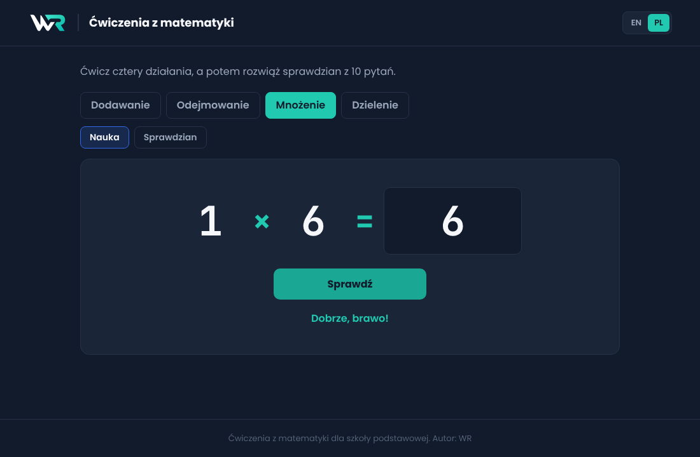
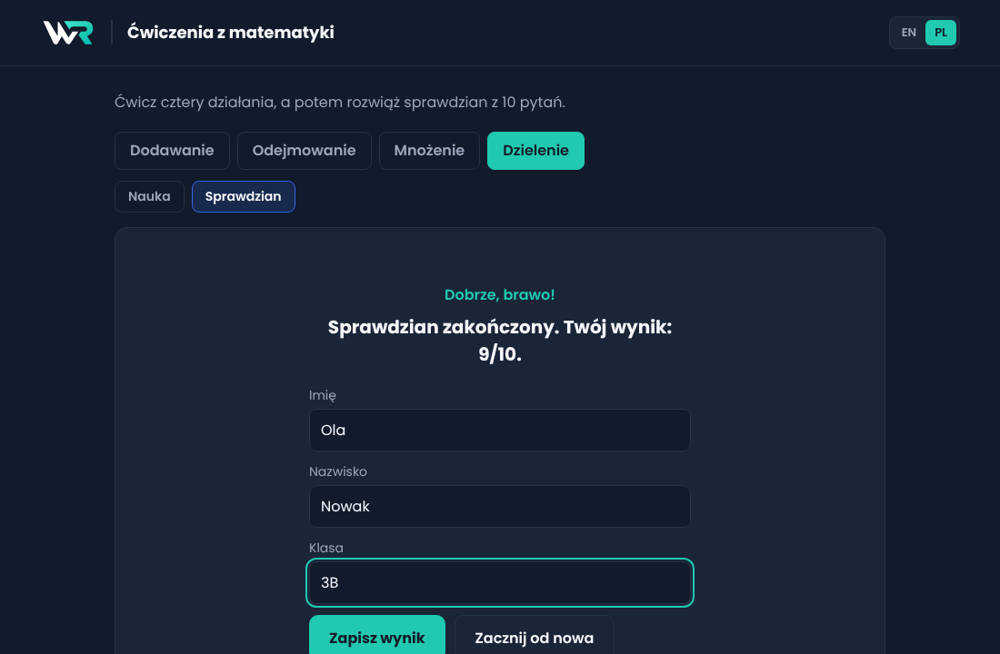
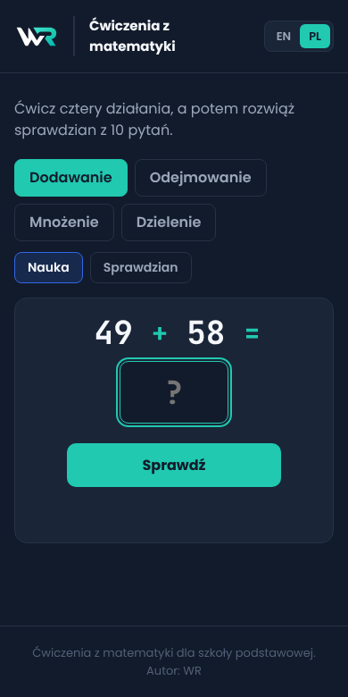

<p>
  
</p>

<p><a href="README.md"></a>&nbsp;</p>

<p>
  
  
  
  <a href="../../actions/workflows/ci.yml"></a>
  
</p>

**Strona do ćwiczenia dodawania, odejmowania, mnożenia i dzielenia.**
Dwa tryby: nieskończona nauka z natychmiastową odpowiedzią albo sprawdzian z 10 pytań, którego wynik zapisuje się w bazie razem z imieniem i klasą ucznia.

<p align="center"></p>

## Funkcje

- **Cztery działania**: odejmowanie nigdy nie schodzi poniżej zera, dzielenie zawsze daje wynik całkowity.
- **Tryby Nauka i Sprawdzian**; sprawdzian zapisuje wynik zapytaniem przygotowanym (bez SQL injection).
- **Angielski i polski** na jednej stronie (`?lang=en|pl`, domyślnie język przeglądarki).
- **Wygląd WR**: logo, kolory ink i signal, Poppins i JetBrains Mono; działa na telefonie.

## Szybki start

Wymagania: PHP 8.1+ z `pdo_mysql`, MariaDB albo MySQL.

```bash
git clone https://github.com/vviktooor/mathLearningSite.git
cd mathLearningSite
mysql -e 'CREATE DATABASE math_learning' && mysql math_learning < db/schema.sql
DB_USER=... DB_PASSWORD=... php -S localhost:8080 -t public
```

Otwórz http://localhost:8080. W XAMPP ustaw katalog strony na `public/`.

## Konfiguracja

Ustawienia bazy pochodzą ze zmiennych środowiskowych (zobacz `.env.example`): `DB_HOST`, `DB_NAME`, `DB_USER`, `DB_PASSWORD`.

## Tryb sprawdzianu

Po dziesięciu pytaniach uczeń widzi wynik i go zapisuje; na telefonie układ się składa:

<p align="center">&nbsp;</p>

## Języki

Ten README jest po polsku i po [angielsku](README.md) (wersja domyślna). Interfejs: domyślnie angielski (albo język przeglądarki), polski przez przełącznik EN/PL lub `?lang=pl`. Teksty są w `lang/en.php` i `lang/pl.php`.

## Struktura repozytorium

| Gdzie | Co |
|---|---|
| `public/index.php` | Jedyna strona: język, działanie i tryb z adresu URL |
| `public/save.php` | Zapis zakończonego sprawdzianu (zapytanie przygotowane) |
| `public/assets/` | `quiz.js` (logika), `app.js` (strona), `style.css`, logo WR |
| `lang/` | `en.php` i `pl.php` |
| `db/schema.sql` | Tabela wyników |
| `tests/` | Testy Node logiki quizu, kontrola PHP zgodności języków |
| `docs/screenshots/` | Zrzuty z działającej strony |

## Testy i jakość

```bash
npm test
php tests/lang_test.php
for f in public/*.php lang/*.php; do php -l "$f"; done
```

| Kontrola | Wynik | Data |
|---|---|---|
| Testy | PASS (3/3 Node, 26/26 kluczy językowych) | 2026-11-25 |
| php -l | PASS | 2026-11-25 |
| Zrzuty ekranu | PASS (PHP 8.3 + MariaDB, wynik zapisany w bazie, EN i PL, komputer i telefon) | 2026-11-25 |

## Licencja

Brak pliku licencji: wszelkie prawa zastrzeżone. Zapytaj przed ponownym użyciem kodu. Autor: WR.

Znalazłeś błąd albo masz pomysł? [Zgłoś go w Issues](../../issues).
