<p>
  
</p>

<p><a href="README.md">English</a> · <b>Polski</b></p>

<p>
  
  
  
  
</p>

**Strona do ćwiczenia dodawania, odejmowania, mnożenia i dzielenia.**
Dwa tryby: nieskończone losowe zadania albo test z dziesięciu zadań, którego wynik zapisuje się w bazie.

[Zgłoś problem](../../issues)

<p align="center"></p>

## Czego się nauczyłem

- **Cztery działania** w trybie losowym i testowym.
- **Wersja polska i angielska** (`pl/`, `en/`).
- **Responsywny** układ na komputer i telefon.

## Szybki start

Wymagania: XAMPP (Apache + MySQL) albo podobny serwer PHP.

```bash
git clone https://github.com/vviktooor/mathLearningSite.git
# skopiuj folder do xampp/htdocs, uruchom Apache i MySQL
# zaimportuj kalkulator.sql w phpMyAdmin, potem otwórz http://localhost/mathLearningSite
```

## Języki

Ten README jest po polsku i po [angielsku](README.md) (wersja domyślna). Strona ma wersję polską (`index.html`) i angielską (`index_en.html`).

## Struktura repozytorium

| Gdzie | Co |
|---|---|
| `index.html, index_en.html` | Strony startowe (PL, EN) |
| `pl/, en/` | Ćwiczenia w każdym języku |
| `kalkulator.sql` | Baza wyników testów |
| `css/, img/` | Style i obrazy |

## Testy i jakość

| Kontrola | Wynik | Data |
|---|---|---|
| Testy | NOT VERIFIED (repozytorium do nauki) | 2026-11-25 |

## Licencja

Brak pliku licencji: wszelkie prawa zastrzeżone. Zapytaj przed ponownym użyciem kodu.
Autor: WR

---

<p align="center"><sub><b>WR</b> · <a href="https://github.com/vviktooor">vviktooor</a></sub></p>
